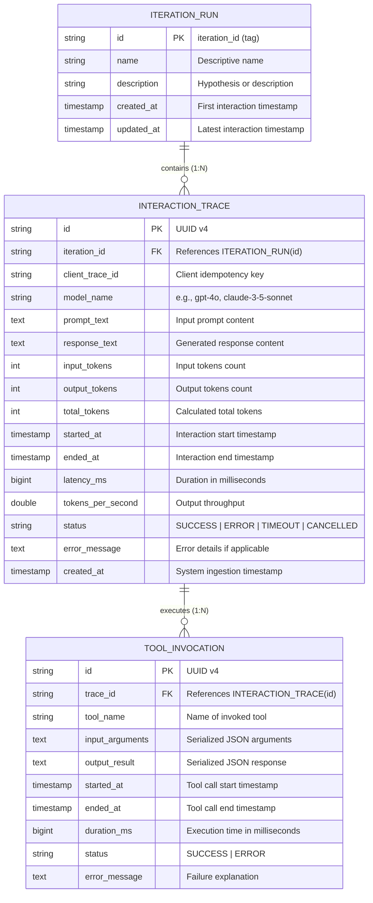

# Data Model: LLM Performance Analytics Platform

**Feature**: `001-llm-performance-analytics`  
**Date**: 2026-10-14  
**Status**: Completed  

---

## 1. Entity-Relationship Diagram



---

## 2. Relational Schema & Tables

### 2.1 Table: `iteration_runs`
Almacena las agrupaciones lógicas de iteraciones creadas automáticamente por tag o enriquecidas vía UI.

```sql
CREATE TABLE iteration_runs (
    id VARCHAR(64) PRIMARY KEY,
    name VARCHAR(255) NOT NULL,
    description TEXT,
    created_at TIMESTAMP WITH TIME ZONE NOT NULL DEFAULT CURRENT_TIMESTAMP,
    updated_at TIMESTAMP WITH TIME ZONE NOT NULL DEFAULT CURRENT_TIMESTAMP
);

CREATE INDEX idx_iteration_created_at ON iteration_runs(created_at DESC);
```

### 2.2 Table: `interaction_traces`
Almacena el registro detallado de cada turno de conversación o inferencia con un LLM.

```sql
CREATE TABLE interaction_traces (
    id VARCHAR(64) PRIMARY KEY,
    iteration_id VARCHAR(64) NOT NULL REFERENCES iteration_runs(id) ON UPDATE CASCADE,
    client_trace_id VARCHAR(128),
    model_name VARCHAR(128) NOT NULL,
    prompt_text TEXT NOT NULL,
    response_text TEXT,
    input_tokens INT NOT NULL CHECK (input_tokens >= 0),
    output_tokens INT NOT NULL CHECK (output_tokens >= 0),
    total_tokens INT NOT NULL CHECK (total_tokens >= 0),
    started_at TIMESTAMP WITH TIME ZONE NOT NULL,
    ended_at TIMESTAMP WITH TIME ZONE NOT NULL,
    latency_ms BIGINT NOT NULL CHECK (latency_ms >= 0),
    tokens_per_second DOUBLE PRECISION NOT NULL DEFAULT 0.0,
    status VARCHAR(32) NOT NULL DEFAULT 'SUCCESS',
    error_message TEXT,
    created_at TIMESTAMP WITH TIME ZONE NOT NULL DEFAULT CURRENT_TIMESTAMP,
    CONSTRAINT chk_status CHECK (status IN ('SUCCESS', 'ERROR', 'TIMEOUT', 'CANCELLED'))
);

CREATE INDEX idx_traces_iteration ON interaction_traces(iteration_id);
CREATE INDEX idx_traces_created_at ON interaction_traces(created_at DESC);
CREATE INDEX idx_traces_latency ON interaction_traces(latency_ms);
CREATE INDEX idx_traces_model ON interaction_traces(model_name);
CREATE INDEX idx_traces_iter_created ON interaction_traces(iteration_id, created_at DESC);
CREATE UNIQUE INDEX uq_client_trace_id ON interaction_traces(iteration_id, client_trace_id) 
    WHERE client_trace_id IS NOT NULL;
```

### 2.3 Table: `tool_invocations`
Almacena las invocaciones de herramientas asociadas a cada interacción para el desglose en cascada (*waterfall timeline*).

```sql
CREATE TABLE tool_invocations (
    id VARCHAR(64) PRIMARY KEY,
    trace_id VARCHAR(64) NOT NULL REFERENCES interaction_traces(id) ON DELETE CASCADE,
    tool_name VARCHAR(128) NOT NULL,
    input_arguments TEXT,
    output_result TEXT,
    started_at TIMESTAMP WITH TIME ZONE NOT NULL,
    ended_at TIMESTAMP WITH TIME ZONE NOT NULL,
    duration_ms BIGINT NOT NULL CHECK (duration_ms >= 0),
    status VARCHAR(32) NOT NULL DEFAULT 'SUCCESS',
    error_message TEXT,
    CONSTRAINT chk_tool_status CHECK (status IN ('SUCCESS', 'ERROR'))
);

CREATE INDEX idx_tools_trace_id ON tool_invocations(trace_id);
CREATE INDEX idx_tools_name ON tool_invocations(tool_name);
```

---

## 3. Data Transfer Objects (DTOs) & Aggregations

### 3.1 Ingestion Payload (`TraceIngestRequest`)
```json
{
  "clientTraceId": "trace-uuid-1234",
  "iterationId": "v2-prompt-optimized",
  "modelName": "gpt-4o",
  "promptText": "¿Cuál es la capital de Francia y su población estimada?",
  "responseText": "La capital de Francia es París con aprox. 2.1 millones de habitantes.",
  "inputTokens": 45,
  "outputTokens": 82,
  "startedAt": "2026-10-14T10:00:00.000Z",
  "endedAt": "2026-10-14T10:00:01.250Z",
  "status": "SUCCESS",
  "errorMessage": null,
  "tools": [
    {
      "toolName": "database_lookup",
      "inputArguments": "{\"query\": \"Paris population\"}",
      "outputResult": "{\"result\": 2161000}",
      "startedAt": "2026-10-14T10:00:00.300Z",
      "endedAt": "2026-10-14T10:00:00.550Z",
      "status": "SUCCESS",
      "errorMessage": null
    }
  ]
}
```

### 3.2 Performance Summary DTO (`PerformanceSummaryDto`)
Calculado a nivel global o por iteración:
```json
{
  "iterationId": "v2-prompt-optimized",
  "totalInteractions": 150,
  "successCount": 147,
  "errorCount": 3,
  "errorRatePercentage": 2.0,
  "latencyMetrics": {
    "minMs": 420,
    "avgMs": 1150.4,
    "p50Ms": 980,
    "p90Ms": 1820,
    "p95Ms": 2350,
    "maxMs": 4810
  },
  "tokenMetrics": {
    "totalInputTokens": 18500,
    "totalOutputTokens": 32400,
    "totalTokens": 50900,
    "avgTokensPerInteraction": 339.3,
    "avgTokensPerSecond": 42.8
  },
  "toolUsage": [
    {
      "toolName": "database_lookup",
      "callCount": 85,
      "avgDurationMs": 245.2,
      "totalDurationMs": 20842
    }
  ]
}
```

### 3.3 Iteration Comparison DTO (`IterationComparisonDto`)
Contraste directo entre dos iteraciones (Base vs Candidata):
```json
{
  "baseIteration": {
    "iterationId": "v1-prompt-baseline",
    "name": "Prompt Base",
    "avgLatencyMs": 1650.0,
    "avgTotalTokens": 450.0,
    "avgTokensPerSecond": 31.2,
    "errorRatePercentage": 4.5
  },
  "targetIteration": {
    "iterationId": "v2-prompt-optimized",
    "name": "Prompt Optimizado",
    "avgLatencyMs": 1150.4,
    "avgTotalTokens": 339.3,
    "avgTokensPerSecond": 42.8,
    "errorRatePercentage": 2.0
  },
  "deltas": {
    "latencyDeltaPercentage": -30.28,
    "tokensDeltaPercentage": -24.60,
    "speedupPercentage": 37.18,
    "errorRateDelta": -2.5
  }
}
```
