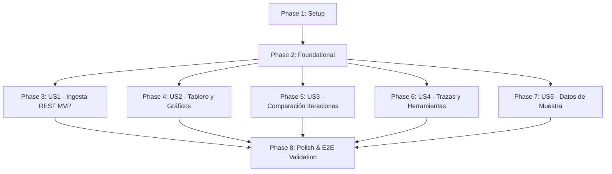

# Tasks: LLM Performance Analytics Platform

**Feature**: `001-llm-performance-analytics` | **Date**: 2026-10-14 | **Branch**: `001-llm-performance-analytics`  
**Spec**: [spec.md](file:///c:/Users/mhernandez/Proyectos/Originador/specs/001-llm-performance-analytics/spec.md) | **Plan**: [plan.md](file:///c:/Users/mhernandez/Proyectos/Originador/specs/001-llm-performance-analytics/plan.md)

---

## Phase 1: Setup (Shared Infrastructure)

**Purpose**: Project initialization, monorepo layout, Docker Compose, and build configurations.

- [X] T001 Create root multi-stage Dockerfile and docker-compose.yml in repository root `docker-compose.yml` configuring PostgreSQL 16 Alpine (port 5432, volume `postgres_data`) and Spring Boot Java 25 runtime (port 8080) with `.env.example`
- [X] T002 [P] Initialize Spring Boot backend Maven project descriptor in `backend/pom.xml` with Java 25 LTS, Spring Boot 3.4+, Spring Data JPA, PostgreSQL driver, Jakarta Validation, and Actuator
- [X] T003 [P] Initialize React frontend project in `frontend/package.json` with TypeScript 5, Vite, React 18/19, Axios, Chart.js, react-chartjs-2, and configure build output to `backend/src/main/resources/static` in `frontend/vite.config.ts`
- [X] T004 [P] Configure Spring application properties in `backend/src/main/resources/application.yml` and `backend/src/main/resources/application-docker.yml` binding `SPRING_DATASOURCE_URL`, `POSTGRES_USER`, `POSTGRES_PASSWORD`, and `APP_API_KEY`

---

## Phase 2: Foundational (Blocking Prerequisites)

**Purpose**: Core data layer, API security filter, error handling, SPA forwarding, and resilient frontend HTTP client.

- [X] T005 Create JPA entities `IterationRun` in `backend/src/main/java/com/originador/analytics/model/IterationRun.java`, `InteractionTrace` in `backend/src/main/java/com/originador/analytics/model/InteractionTrace.java`, and `ToolInvocation` in `backend/src/main/java/com/originador/analytics/model/ToolInvocation.java` with constraints: `status IN ('SUCCESS', 'ERROR', 'TIMEOUT', 'CANCELLED')`, `input_tokens >= 0`, `output_tokens >= 0`, `latency_ms >= 0`
- [X] T006 [P] Create Spring Data JPA repositories `IterationRunRepository.java`, `InteractionTraceRepository.java`, and `ToolInvocationRepository.java` in `backend/src/main/java/com/originador/analytics/repository/` with custom queries for percentiles and iteration aggregates
- [X] T007 [P] Implement `ApiKeyAuthFilter.java` in `backend/src/main/java/com/originador/analytics/config/ApiKeyAuthFilter.java` to validate `X-API-Key` header against `APP_API_KEY`, returning HTTP 401 Unauthorized for missing or invalid keys
- [X] T008 [P] Implement global exception handler `GlobalExceptionHandler.java` in `backend/src/main/java/com/originador/analytics/config/GlobalExceptionHandler.java` handling validation errors, 400 Bad Request, 404 Not Found, and returning structured `ErrorResponse`
- [X] T009 [P] Implement `SpaForwardingController.java` in `backend/src/main/java/com/originador/analytics/config/SpaForwardingController.java` forwarding all non-API routes (`/{path:[^\\.]*}`) to `forward:/index.html`
- [X] T010 [P] Configure resilient frontend HTTP client `apiClient.ts` in `frontend/src/services/apiClient.ts` with base URL `/api/v1`, 8000ms timeout, automatic `X-API-Key` injection, and 401 interceptor
- [X] T011 [P] Create TypeScript interface definitions in `frontend/src/types/api.ts` mapping OpenAPI schemas (`TraceIngestRequest`, `TraceResponse`, `IterationSummary`, `PerformanceSummaryDto`, `IterationComparisonDto`)
- [X] T012 [P] Implement main application shell, header, and navigation in `frontend/src/components/layout/Header.tsx` and `frontend/src/components/layout/Navigation.tsx`

**Checkpoint**: Foundation ready — User Story implementation can proceed in parallel.

---

## Phase 3: User Story 1 - Ingesta Automatizada de Métricas vía API REST (Priority: P1) 🎯 MVP

**Goal**: Permitir que sistemas y agentes clientes envíen métricas de chats (individual y por lotes) vía REST API con validación estricta y autenticación `X-API-Key`.

**Independent Test**: Enviar peticiones `curl` con JSON de traza individual y lote a `/api/v1/traces` y `/api/v1/traces/batch`, verificando código HTTP 201 Created y confirmación con ID único.

### Tests for User Story 1 🧪
- [X] T013 [P] [US1] Unit test for trace metrics calculation (latency in ms, tokens per second throughput) in `backend/src/test/java/com/originador/analytics/unit/TraceCalculationTest.java`
- [X] T014 [P] [US1] Integration test for single and batch ingestion endpoints with API Key verification in `backend/src/test/java/com/originador/analytics/integration/TraceIngestionIntegrationTest.java`

### Implementation for User Story 1
- [X] T015 [US1] Implement DTOs `TraceIngestRequest.java`, `ToolInvocationDto.java`, `TraceResponse.java`, and `BatchIngestResponse.java` in `backend/src/main/java/com/originador/analytics/dto/`
- [X] T016 [US1] Implement `TraceIngestionService.java` in `backend/src/main/java/com/originador/analytics/service/TraceIngestionService.java` supporting tag-based iteration auto-creation, single trace persistence, and batch processing (`saveAll` with batching)
- [X] T017 [US1] Implement REST controller `TraceController.java` in `backend/src/main/java/com/originador/analytics/controller/TraceController.java` exposing `POST /api/v1/traces` and `POST /api/v1/traces/batch`
- [X] T018 [US1] Implement frontend service wrapper `traceService.ts` in `frontend/src/services/traceService.ts` exposing `ingestTrace` and `ingestBatch`

**Checkpoint**: User Story 1 (MVP) fully functional and testable independently.

---

## Phase 4: User Story 2 - Tablero Visual y Gráficos de Rendimiento (Priority: P1)

**Goal**: Visualizar indicadores clave (latencia media, percentiles p50/p95, total de tokens, tokens/seg) y gráficos interactivos de evolución temporal y herramientas.

**Independent Test**: Acceder a `http://localhost:8080` y comprobar el renderizado dinámico de tarjetas KPI, gráfico de líneas de latencia, gráfico de barras de tokens (in/out) y gráfico de herramientas.

### Tests for User Story 2 🧪
- [X] T019 [P] [US2] Unit test for metrics aggregation service (p50, p90, p95 calculation, token throughput, error rate) in `backend/src/test/java/com/originador/analytics/unit/MetricsCalculationServiceTest.java`

### Implementation for User Story 2
- [X] T020 [US2] Implement `MetricsCalculationService.java` in `backend/src/main/java/com/originador/analytics/service/MetricsCalculationService.java` computing KPIs, latency percentiles, token distributions, and tool breakdown stats
- [X] T021 [US2] Implement REST controller `MetricsController.java` in `backend/src/main/java/com/originador/analytics/controller/MetricsController.java` exposing `GET /api/v1/metrics/summary` with `timeRange` query parameter
- [X] T022 [P] [US2] Create KPI metric cards and skeleton loaders in `frontend/src/components/common/KpiCard.tsx` and `frontend/src/components/common/LoadingSkeleton.tsx`
- [X] T023 [P] [US2] Create latency timeline chart component in `frontend/src/components/charts/LatencyTimelineChart.tsx` displaying latency evolution and p95 thresholds
- [X] T024 [P] [US2] Create token distribution chart component in `frontend/src/components/charts/TokenDistributionChart.tsx` displaying input vs output tokens
- [X] T025 [P] [US2] Create tool calling breakdown chart component in `frontend/src/components/charts/ToolBreakdownChart.tsx` showing call count and duration by tool
- [X] T026 [US2] Build `DashboardPage.tsx` in `frontend/src/pages/DashboardPage.tsx` integrating KPI cards, time-range filter, and all analytical charts with loading/empty/error states

**Checkpoint**: User Stories 1 and 2 working together seamlessly.

---

## Phase 5: User Story 3 - Gestión y Comparación entre Iteraciones (Priority: P2)

**Goal**: Agrupar trazas automáticamente por tag (`iteration_id`), editar metadatos descriptivos y comparar el rendimiento lado a lado entre dos iteraciones con cálculo de deltas.

**Independent Test**: Seleccionar dos iteraciones en la interfaz web y verificar que se despliegue la vista comparativa resaltando la reducción porcentual de latencia y variación de tokens.

### Tests for User Story 3 🧪
- [X] T027 [P] [US3] Unit test for iteration delta comparison calculations in `backend/src/test/java/com/originador/analytics/unit/IterationComparisonTest.java`

### Implementation for User Story 3
- [X] T028 [US3] Implement `IterationService.java` in `backend/src/main/java/com/originador/analytics/service/IterationService.java` listing iterations with aggregate stats, updating iteration metadata, and calculating deltas between `baseId` and `targetId`
- [X] T029 [US3] Implement REST controller `IterationController.java` in `backend/src/main/java/com/originador/analytics/controller/IterationController.java` exposing `GET /api/v1/iterations`, `GET /api/v1/iterations/{id}`, `PUT /api/v1/iterations/{id}`, and `GET /api/v1/iterations/compare`
- [X] T030 [P] [US3] Implement iteration selector and metadata editor in `frontend/src/components/iterations/IterationSelector.tsx` and `frontend/src/components/iterations/IterationMetadataModal.tsx`
- [X] T031 [US3] Implement side-by-side comparison view in `frontend/src/components/iterations/IterationComparisonView.tsx` displaying delta badges (latency change %, token savings %, speedup %)
- [X] T032 [US3] Build `IterationsPage.tsx` in `frontend/src/pages/IterationsPage.tsx` displaying iterations table, metadata editing, and side-by-side comparison trigger

**Checkpoint**: Iteration management and side-by-side comparison fully functional.

---

## Phase 6: User Story 4 - Detalle de Trazas e Invocación de Herramientas (Priority: P2)

**Goal**: Permitir la búsqueda y filtrado de trazas con visor detallado que desglosa el prompt completo, la respuesta y la línea de tiempo en cascada (*waterfall*) de herramientas.

**Independent Test**: Hacer clic en una traza individual de la tabla y comprobar que se abra el modal con el texto íntegro y el gráfico de línea de tiempo separando tiempo de inferencia de cada invocación de herramienta.

### Tests for User Story 4 🧪
- [X] T033 [P] [US4] Integration test for filtered traces list and trace detail retrieval in `backend/src/test/java/com/originador/analytics/integration/TraceQueryIntegrationTest.java`

### Implementation for User Story 4
- [X] T034 [US4] Implement trace query and filtering methods in `TraceIngestionService.java` and expose `GET /api/v1/traces` (paginated, filtered by iteration, model, status, latency) and `GET /api/v1/traces/{id}` in `backend/src/main/java/com/originador/analytics/controller/TraceController.java`
- [X] T035 [P] [US4] Create paginated traces table with filters in `frontend/src/components/traces/TraceTable.tsx` supporting status chips, latency badges, and quick search
- [X] T036 [US4] Create trace detail modal with waterfall timeline in `frontend/src/components/traces/TraceDetailModal.tsx` showing prompt, response, token breakdown, and visual execution timeline separating LLM inference from tool calls
- [X] T037 [US4] Build `TracesPage.tsx` in `frontend/src/pages/TracesPage.tsx` integrating `TraceTable` and `TraceDetailModal`
- [X] T038 [P] [US4] Implement data export functionality (JSON and CSV formats) for interaction traces and metric summaries in `frontend/src/components/traces/ExportTracesButton.tsx` and utility `frontend/src/utils/exportUtils.ts`

**Checkpoint**: Trace inspection, tool waterfall timeline, and data export functional.

---

## Phase 7: User Story 5 - Datos de Muestra Predefinidos y Modo Demo (Priority: P3)

**Goal**: Proveer un conjunto de datos representativo precargable con un solo clic para explorar y demostrar la plataforma sin clientes externos conectados.

**Independent Test**: Ejecutar `POST /api/v1/sample-data/seed` o pulsar el botón en la cabecera web y verificar que se pueblen 3 iteraciones y más de 30 trazas interactivas.

### Tests for User Story 5 🧪
- [X] T039 [P] [US5] Unit test for sample dataset generator in `backend/src/test/java/com/originador/analytics/unit/SampleDataServiceTest.java`

### Implementation for User Story 5
- [X] T040 [US5] Implement `SampleDataService.java` in `backend/src/main/java/com/originador/analytics/service/SampleDataService.java` generating 3 realistic iterations (`v1-prompt-baseline`, `v2-prompt-optimized`, `v3-agentic-tools`) with 30+ traces, parallel tool calls, errors, and resets
- [X] T041 [US5] Implement REST controller `SampleDataController.java` in `backend/src/main/java/com/originador/analytics/controller/SampleDataController.java` exposing `POST /api/v1/sample-data/seed` and `DELETE /api/v1/sample-data/reset`
- [X] T042 [US5] Add sample data load/reset action button and banner in `frontend/src/components/layout/Header.tsx` allowing one-click demo population

**Checkpoint**: Demo data population and reset fully functional.

---

## Phase 8: Polish & Cross-Cutting Concerns

**Purpose**: Security hardening, responsive design verification, accessibility audit, and E2E validation.

- [X] T043 [P] Configure security hardening and CORS configuration in `backend/src/main/java/com/originador/analytics/config/WebMvcConfig.java`
- [X] T044 [P] Implement responsive styling, accessibility audit (keyboard navigation, ARIA labels, contrast) across all React views in `frontend/src/index.css`
- [X] T045 Run complete end-to-end quickstart validation scenarios from `specs/001-llm-performance-analytics/quickstart.md` using Docker Compose

---

## Dependencies & Execution Order

### Phase Dependencies

- **Setup (Phase 1)**: Sin dependencias — inicio inmediato.
- **Foundational (Phase 2)**: Depende de Setup — **BLOQUEA** todas las historias de usuario.
- **User Stories (Phases 3 a 7)**: Dependen de la finalización de Foundational.
  - US1 es el MVP funcional primario.
  - US2, US3, US4 y US5 pueden avanzar secuencialmente o en paralelo si hay capacidad.
- **Polish (Phase 8)**: Requiere que las historias de usuario deseadas estén completas.

---

## Parallel Opportunities

- **Setup**: T002, T003 y T004 pueden ejecutarse en paralelo una vez creado T001.
- **Foundational**: T006, T007, T008, T009, T010, T011 y T012 pueden ejecutarse en paralelo tras T005.
- **Por Historia de Usuario**: Las pruebas unitarias/integración ([P]) pueden escribirse en paralelo con la definición de DTOs y componentes UI antes de la integración final.

---

## Implementation Strategy

### MVP First (User Story 1 Focus)
1. Completar **Fase 1: Setup** (Estructura, Docker Compose, Maven, Vite).
2. Completar **Fase 2: Foundational** (Entidades JPA, Repositorios, Filtro API Key, Cliente Axios).
3. Completar **Fase 3: User Story 1** (Ingesta REST individual y por lotes).
4. **Validar MVP**: Probar ingesta con `curl` verificando persistencia en PostgreSQL y HTTP 201 Created.

### Entrega Incremental
1. MVP listo → Incorporar **Fase 4: User Story 2** para disponer de visualizaciones y KPIs en el navegador.
2. Incorporar **Fase 5: User Story 3** para habilitar la comparación de experimentos de prompts.
3. Incorporar **Fase 6: User Story 4** para inspección detallada de trazas y cascada de herramientas.
4. Incorporar **Fase 7: User Story 5** para activar el modo de demostración con un solo clic.
5. Ejecutar **Fase 8: Polish & E2E** para validar la plataforma de extremo a extremo.

---

## Phase 9: Convergence

- [X] T046 [CRITICAL] Create and checkout dedicated branch `feature/001-llm-performance-analytics` to isolate development from main per Constitution VI (contradicts)
- [X] T047 Add chronological time-series data points (latency and throughput over time) to metrics API and render interactive time-series charts in `DashboardPage.tsx` per FR-007 (partial)
- [X] T048 Implement one-click navigation from dashboard latency outliers (p95) and error badges to filtered list in `TracesPage.tsx` per SC-005 (missing)
- [X] T049 Add date range (`startDate`, `endDate`) and tool presence (`hasTools`) query filters in `TraceIngestionService` and `TraceTable.tsx` per FR-008 (partial)
- [X] T050 Add chronological validation in `TraceIngestRequest` to reject `endedAt` prior to `startedAt` with HTTP 400 Bad Request per US1/AC2, FR-013 (partial)
- [X] T051 Configure Vitest and React Testing Library in `frontend/package.json` with unit tests for UI utilities and components per Constitution II, plan.md (missing)

